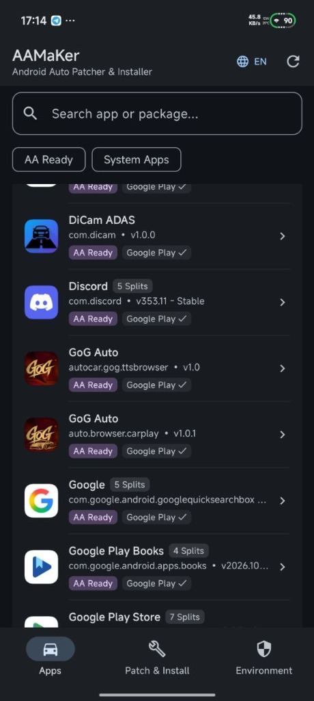
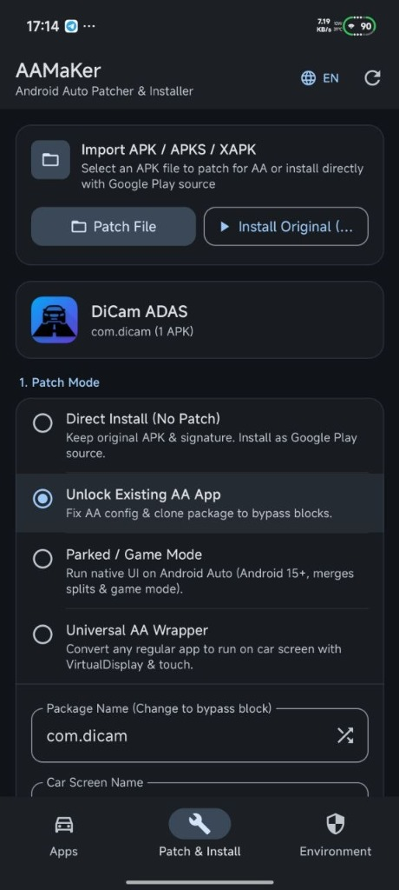
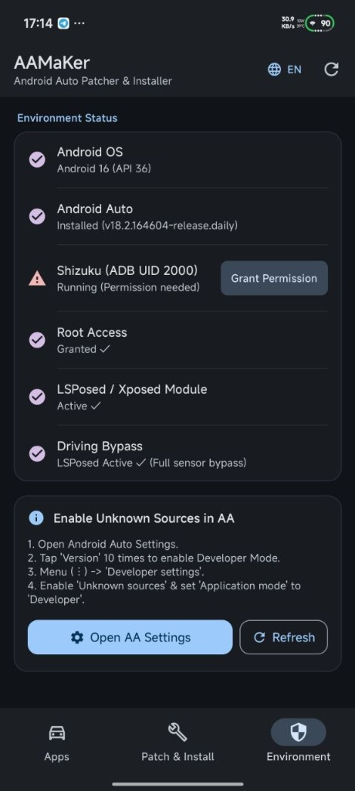

# AAMaKer — Any App on Android Auto

**AAMaKer** is an all-in-one Android Auto APK Patcher and Google Play Source Installer. It allows you to unlock third-party Android Auto apps, run standard Android applications (videos, maps, browsers, games, dashboards) directly on your car's head unit screen, and bypass installation source & driving restrictions.

---

## 📱 Screenshots

<p align="center">
  
  &nbsp;&nbsp;
  
  &nbsp;&nbsp;
  
</p>

---

## ✨ Key Features

### 🛠️ 4 Versatile Patching & Processing Modes
- **Parked / Game Mode (Default):** Runs the app's native UI directly on Android Auto (ideal for Android 15+), automatically merges Split APKs into a single standalone APK, and injects `CAR_LAUNCHER` & game mode declarations.
- **Universal AA Wrapper:** Converts any standard Android app into an Android Auto compatible app by injecting a lightweight Car App Runtime DEX (`VirtualDisplay` projection + interactive touch forwarding).
- **Unlock Existing AA App:** Fixes `automotive_app_desc.xml` metadata and clones/renames the package name to bypass package blacklists on apps that already include Android Auto support.
- **Direct Install (No Patch):** Preserves the original APK/Split APKs and original digital signature while spoofing the installer source as Google Play Store (`com.android.vending`).

### 📦 Advanced APK & Bundle Engine
- **Split APK & Bundle Merger:** Automatically extracts and merges `.apks`, `.xapk`, and `.apkm` bundles (or installed split apps) into a single, signed APK while stripping restrictive split metadata (`INSTALL_FAILED_MISSING_SPLIT` protection) and integrating OBB assets.
- **Package & App Name Customization:** Customize or randomize the output package name to install alongside the original app or bypass package-name blocks, and customize the display name shown on your car screen.
- **Car Launcher Category Selection:** Categorize patched apps under **Navigation**, **IoT / Dashboard**, **Media / Audio**, or **Points of Interest (POI)**.
- **Compatibility & Hardware Enhancements:**
  - **Use While Driving (`distractionOptimized`):** Injects distraction-optimized flags across activities so apps remain usable while the vehicle is in motion.
  - **Gamepad Support:** Injects hardware controller compatibility flags and relaxes mandatory hardware `uses-feature` constraints.
  - **Widescreen & Orientation Unlock:** Unlocks screen rotation and full-screen aspect ratios for car head units.
  - **Touch Bridge:** Built-in Accessibility Touch Bridge service and optional Root shell (`su`) touch injection for Universal AA Wrapper apps.

### 🚀 Multi-Mode Google Play Source Installer
Android Auto blocks sideloaded apps unless they appear to be installed from the Google Play Store (`com.android.vending`). AAMaKer provides **4 installation backends**:
1. **Shizuku (Recommended - No Root):** Uses ADB privileges (`UID 2000`) via Shizuku to install packages with an authentic Google Play install source on Android 11+.
2. **Root (Magisk / KernelSU / APatch):** Installs directly via root shell (`pm install -i com.android.vending`) and automatically grants required projection/overlay permissions.
3. **LSPosed / Xposed Module:** Includes a built-in Xposed module (`GearheadXposedHook`) that hooks Android Auto (`com.google.android.projection.gearhead`) and Google Play Services (`com.google.android.gms`) to bypass install-source checks, unlock `distractionOptimized` activities, and spoof parking brake / zero speed sensor events in real time.
4. **Standard Non-Root Session Installer:** Uses Android's `PackageInstaller` Session API (best for Android 10–13 when combined with Android Auto Developer Mode).

### 🌍 Modern UI & Multi-Language Support
- Built with Jetpack Compose featuring a custom dark OLED **Liquid Glass** UI with real-time AGSL shader refraction.
- Supports **11 languages** out of the box: English, Vietnamese, Chinese (Simplified), Spanish, Hindi, Arabic (RTL), Portuguese, Russian, Japanese, German, and French.

---

## 📋 Prerequisites & Setup

### 1. Requirements
- **Android Version:** Android 8.0 (API 26) or higher (Android 11+ recommended for Shizuku; Android 15+ supported for native Parked/Game mode).
- **Android Auto:** Installed and updated on your phone.

### 2. Enable "Unknown Sources" in Android Auto
Before patched apps can appear on your car launcher, enable Developer Mode in Android Auto:
1. Open **Settings** on your phone and search for **Android Auto**.
2. Scroll to the bottom and tap **Version** 10 times until Developer Mode is unlocked.
3. Tap the three-dot menu (**⋮**) in the top-right corner and select **Developer settings**.
4. Set **Application mode** to **Developer** and check **Unknown sources**.

*(Tip: You can open Android Auto Settings directly from the **Environment** tab inside AAMaKer).*

### 3. Choose Your Privileged Environment (Recommended)
To ensure Android Auto recognizes patched apps as coming from Google Play:
- **Non-Root Users:** Install and start [**Shizuku**](https://shizuku.rikka.app/) (via Wireless Debugging or PC ADB), then grant Shizuku permission inside AAMaKer's **Environment** tab.
- **Root Users:** Grant Superuser permission to AAMaKer in Magisk, KernelSU, or APatch.
- **LSPosed Users:** Enable **AAMaKer** in the LSPosed Manager, check both **Android Auto** (`com.google.android.projection.gearhead`) and **Google Play Services** (`com.google.android.gms`) in the module scope, and reboot or force-stop both apps.

---

## 📥 Installation

### Option A: Install Prebuilt APK
1. Download the latest `AAMaKer_*.apk` from the Releases page (or your build output).
2. Install the APK on your Android device.
3. Open **AAMaKer** and go to the **Environment** tab to verify your Android Auto, Shizuku, Root, or LSPosed status.

### Option B: Build from Source
1. Clone this repository:
   ```bash
   git clone https://github.com/your-username/AAMaKer.git
   cd AAMaKer
   ```
2. Build the debug or release APK using the Gradle wrapper (requires JDK 17 and Android SDK 35):
   ```bash
   # Linux / macOS
   ./gradlew assembleDebug

   # Windows (PowerShell / CMD)
   .\gradlew.bat assembleDebug
   ```
3. The compiled APK will be generated in `app/build/outputs/apk/debug/`.

---

## 🔧 How to Patch & Install an App

### Step 1: Select a Target App or APK
1. Open **AAMaKer** and stay on the **Apps** tab.
2. Choose your target from one of two sources:
   - **Installed Apps:** Browse or search your installed apps list. Use the **AA Ready** filter to find apps that already have Android Auto support, or **System Apps** to include system packages. Tap any app to select it.
   - **External File (`APK` / `APKS` / `XAPK` / `APKM`):** Tap **Patch File** at the top banner to import an external package from device storage, or tap **Install Original (Play Source)** if you only want to install an unmodified APK with a Google Play source.

### Step 2: Configure Patch Strategy & Options
Once an app is selected, you will be taken to the **Patch & Install** tab:

1. **Select a Patch Mode (`1. Patch Mode`):**
   - **Parked / Game Mode:** Best for running standard apps/games with their native interface on Android 15+ or compatible head units.
   - **Universal AA Wrapper:** Best for projecting standard apps onto the car screen via VirtualDisplay with touch input.
   - **Unlock Existing AA App:** Best for third-party AA apps that are blocked by Android Auto when sideloaded.
   - **Direct Install (No Patch):** Best when you have an already-patched APK or an original AA app and just need to install it with the Google Play Store installer flag.
2. **Customize Identity (Optional):**
   - **Package Name:** Keep the original package name (requires uninstalling the original app first if signatures differ) or tap the **Randomize** button to generate a new suffix (e.g., `.aa123`) so it installs side-by-side as a clone.
   - **Car Screen Name:** Set a custom label for the app on your car display.
3. **Configure Compatibility & Capabilities:**
   - Toggle **Compatibility Options** such as *Parked Game Mode*, *Use While Driving*, *Gamepad*, and *Widescreen / Rotate*.
   - For *Unlock Existing AA App* or *Universal AA Wrapper*, select the **AA Capabilities** (*Full Screen Projection*, *Car Templates*) and **Launcher Category** (*Navigation*, *IoT*, *Media*, or *POI*).

### Step 3: Select Install Method & Execute
1. Under **`2. Install Method (Play Store Spoof)`**, select your preferred installer:
   - **Shizuku (Recommended)**
   - **Root (Magisk / KernelSU / APatch)**
   - **LSPosed / Xposed**
   - **Standard Non-Root**
2. Tap **Patch & Install** to automatically merge splits, patch the binary manifest/resources, sign the APK, save a copy to `/sdcard/Download/AAMaKer/`, and install it to your device.
   - Alternatively, tap **Patch & Save APK** if you only want to generate and export the patched APK file without installing it immediately.
3. Check the **Console Log** at the bottom of the screen for real-time progress. Once completed, reconnect your phone to your car's Android Auto head unit—your app will now appear in the car launcher!

---

## 🏗️ Project Architecture

| Module | Description |
| :--- | :--- |
| `:app` | Jetpack Compose UI, `MainViewModel`, app discovery repository, 11-language localization, and `AAMakerTouchBridgeService` (Accessibility touch injector). |
| `:core-patcher` | Binary `AndroidManifest.xml` & `resources.arsc` patcher, Split APK / Bundle merger (`.apks`/`.xapk`), DEX injector, and V1/V2/V3 APK signer engine. |
| `:core-installer` | Multi-mode installer supporting Shizuku (`UID 2000`), Root (`libsu`), LSPosed status detection, and standard `PackageInstaller` sessions. |
| `:aa-stub-runtime` | Lightweight runtime stub (`AAMakerCarAppService`) injected into target APKs for Universal AA Wrapper projection and touch forwarding. |
| `:xposed-hook` | LSPosed/Xposed module (`GearheadXposedHook`) hooking Android Auto and Google Play Services for install-source spoofing and driving sensor bypass. |

---

## ⚠️ Disclaimer

This project is intended for educational purposes and personal customization. Running non-optimized applications or video/gaming apps while operating a motor vehicle is dangerous and may be illegal in your jurisdiction. Always pay full attention to the road and only interact with complex applications while your vehicle is safely parked.
